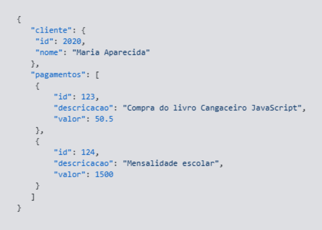
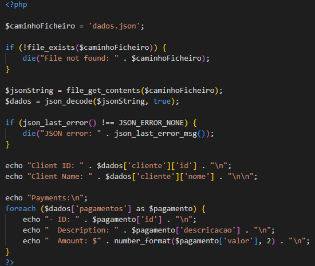

# Pesquisa APIs (Application Programming Interfaces)

## O que é uma API e qual é a sua finalidade?

APIs são mecanismos que permitem que dois componentes de software se comuniquem usando um conjunto de definições e protocolos. Por exemplo, o sistema de software do instituto meteorológico contém dados meteorológicos diários. A aplicação para a previsão do tempo em seu telefone “fala” com esse sistema por meio de APIs e mostra atualizações meteorológicas diárias no telefone. 

Basicamente de uma forma mais elaborada API é um conjunto de regras ou protocolos que permitem que as aplicações de software se comuniquem entre si para trocar dados, recursos e funcionalidades. Um outro exemplo muito bom de uma API é uma integração simples, como permitir que uma loja de comércio eletrônico se comunique com um sistema de pagamento como o PayPal ou permitir que um blog extraia e incorpore posts de um site de rede social.

Em um sistema empresarial, as APIs podem ser usadas para integrar plataformas, sistemas e fluxos de trabalho maiores e mais substanciais, tais como permitir a troca de dados em tempo real entre diferentes bancos de dados empresariais ou conectar aplicações independentes para criar processos de negócios automatizados.

Por fim, a integração com API oferece uma solução mais eficiente. Por meio da integração com API, as organizações podem usar APIs para expor fluxos de integração e integrar aplicações, plataformas e sistemas, não importa onde estejam são cruciais para ambientes de TI modernos hoje em dia.

### O que significa API?

API significa basicamente Application Programming Interface (Interface de Programação de Aplicação). No meio do contexto de APIs, a palavra aplicação refere-se a qualquer software que tem uma função diferente da outra. A interface pode ser pensada como se fosse um contrato de serviço entre duas aplicações. Esse contrato define como as duas se comunicam usando solicitações e respostas. A documentação de suas respectivas APIs contém informações sobre como os desenvolvedores devem estruturar essas solicitações e respostas. 

### Como funciona a comunicação entre sistemas por meio de APIs

A arquitetura da API geralmente é explicada em termos de cliente e servidor. A aplicação que envia a solicitação é chamada de cliente e a aplicação que envia a resposta é chamada de servidor.

Existem 4 maneiras diferentes pelas quais as APIs podem funcionar, dependendo de quando e por que elas foram criadas.

APIs SOAP
Essas APIs usam o Simple Object Access Protocol (Protocolo de Acesso a Objetos Simples). Cliente e servidor trocam mensagens usando XML. Esta é uma API menos flexível que era mais popular no passado.

APIs RPC
Essas APIs são conhecidas como Remote Procedure Calls (Chamadas de Procedimento Remoto). O cliente conclui uma função (ou um procedimento) no servidor e o servidor envia a saída de volta ao cliente.

APIs WebSocket
A API de WebSocket é outro desenvolvimento de API da Web moderno que usa objetos JSON para transmitir dados. Uma API WebSocket oferece suporte à comunicação bidirecional entre aplicativos cliente e o servidor. O servidor pode enviar mensagens de retorno de chamada a clientes conectados, tornando-o mais eficiente que a API REST. 

APIs Rest
Essas são as APIs mais populares e flexíveis encontradas na Web atualmente. O cliente envia solicitações ao servidor como dados. O servidor usa essa entrada do cliente para iniciar funções internas e retorna os dados de saída ao cliente. Vejamos as APIs REST em mais detalhes abaixo. 

### O que São APIs REST?

Rest significa basicamente Transferência Representacional de Estado. Rest define um conjunto de funções como GET, PUT, DELETE e assim que os clientes podem usar para acessar os dados do servidor. Os clientes e servidores trocam dados usando HTTP.

A principal característica da API Rest é a ausência de estado. A ausência de estado significa que os servidores não salvam dados do cliente entre as solicitações. As solicitações do cliente ao servidor são semelhantes aos URLs que você digita no navegador para visitar um site. A resposta do servidor corresponde a dados simples, sem a renderização gráfica típica de uma página da Web. 

### O que são metodos de API?

Os métodos de uma API são as ações que um cliente pode solicitar para um recurso exposto por uma API. Em APIs Rest que são o tipo mais comum de API, os métodos principais são os verbos HTTP padrão: GET, POST, PUTCH, PATCH, DELETE. O método é definido na requisição e informa ao servidor se deve recuperar dados, criar algo novo, atualizar um recurso existente ou remover algum.

#### Métodos seguros vs Métodos Indempotentes:

Os métodos seguros são aqueles que são somente de leitura. Eles recuperam dados sem modificar o estado do servidor e não devem ter efeitos colaterais e são eles GET, HEAD, OPTIONS.

Métodos idempotentes: (GET, HEAD, OPTIONS, PUT, DELETE) podem ser chamados várias vezes sem alterar o resultado além da aplicação inicial.
Post é o elemento destoante: não é seguro nem idempotente. 

Patch é condicionalmente idempotente: depende de como você implementa o patch.

### Métodos:

GET (Buscar/Ler)

O que faz: Solicita os dados de algo que já existe para exibir na sua tela.

Exemplo: Quando você entra no instagram e vê o feed de fotos o insta está fazendo um GET/ posts. Ele apenas puxa a lista de fotos para você ver.

POST (Criar)

O que faz: Cria algo novo no servidor.

Exemplo prático: Você preenche um formulário de cadastro de novo usuário e clica em “salvar”. O servidor gera um novo ID e cria essa conta do zero. Se você enviar o mesmo formulário duas vezes, ele cria dois cadastros iguais não é idempotente.

PUT (Substituir tudo)

O que faz: Sobrescrever um recurso inteiro que já existe.

Exemplo prático: Imagine o formulário de cadastro do usuário. Com o PUT você manda a ficha inteira de novo e o que você esquecer de mandar na nova ficha, ele apaga ou substitui. E se você apertar “salvar” com as mesmas informações 10 vezes, o resultado final é exatamente o mesmo é idempotente.

PATCH (Atualizar só um pedaço)

O que faz: Altera apenas o campo que você especificar, sem mexer no resto do formulário.

Exemplo : Você quer mudar só o seu email, você usa o patch no usuario especifico e o email muda, mas o seu nome e telefone continuam-lá intactos.

DELETE (Apagar)
O que faz: Remove o recurso do servidor.

Exemplo:  Você clica em excluir conta no usuário em específico. O servidor delete aquele usuário e se você tentar deletar de novo a conta não existe mais e dará erro.

### O que são requisições e respostas HTTP?

O HTTP é um protocolo de comunicação. Através dele o cliente e o servidor, conseguem se comunicar, seguindo um conjunto de regras bem definidas, por isso se chamam protocolos.

Requisição/Request:

é o pedido que um cliente realiza a nosso servidor. Esse pedido contém uma série de dados que são usados para descrever exatamente o que o cliente precisa. Vamos pensar que um cliente precisa cadastrar um novo produto, ele deve passar todos os dados necessários para o cadastro acontecer de maneira correta, inclusive os dados que foram digitados pelo usuário em um formulário, no caso de uma aplicação web. No navegador toda vez que trocamos de página ou apertamos enter na barra de endereço uma nova request é feita. Independente se estamos apenas pedindo a exibição de uma página, cadastrando um novo recurso, atualizando ou excluindo. 

Response/Resposta:

Na requisição é informada todas as informações do que o cliente espera receber de volta e no Response nada mais é do que a resposta que o servidor envia ao cliente. Essa resposta pode conter os dados que realmente o cliente esperava receber ou uma resposta informando que alguma coisa deu errado.

### O que são EndPoints:

Os endpoints da API são basicamente os pontos de contato finais no sistema de comunicação da API. Estes incluem URLs de servidores, serviços e outros locais digitais específicos de onde as informações são enviadas e recebidas entre sistemas. Os endopoints da API são fundamentais para as empresas em geral por dois principais motivos:

1- Segurança 

Os endpoints da API tornam o sistema vulnerável a ataques. O monitoramento da API é crucial para impedir o uso indevido.

2- Performance

Os endpoints da API, especialmente os de alto tráfego, podem causar gargalos e afetar a performance do sistema.

## Como funciona a troca de dados no formato JSON

O formato JSON (JavaScript Object Notation) é um padrão leve de troca de dados baseado na notação de objetos do JavaScript. JSON é um formato de arquivo (.json) amplamente usado para representar dados estruturados de uma forma comum a diversas linguagens de programação. 

Essa imagem é uma estrutura de exemplo de .json:

Em seguida esse é um exemplo de decodificação do .json acima em PHP:

## Diferenças entre uma API e um sistema web tradicional

Tanto APIs quanto web services podem operar em máquinas ou redes, mas possuem algumas diferenças estruturais entre eles.

Com as APIs, o cliente/consumidor de dados não precisa saber qual procedimento chamar no servidor – é necessária apenas a utilização de comandos, e o próprio sistema de recebimento já sabe o que fazer com eles.

Além disso, as APIs são consideradas mais flexíveis porque os sistemas do cliente e do serviço podem se comunicar mesmo que cada um utilize linguagens diferentes na implementação.

Dessa forma, os web services funcionam de maneira mais eficiente em um contexto onde a comunicação acontece de máquina para máquina – já as APIs operam melhor em um nível de software para software, fazendo uma busca de informações em aplicativos que são baseados na web.

## Como uma aplicação PHP pode consumir uma API

Consumir APIs é uma funcionalidade que tem se tornado muito comum em sistemas web ou mesmo desktop. Muitas vezes, esse trabalho se torna complicado quando o desenvolvedor desconhece recursos que facilitam a implementação dessas funcionalidades. Uma das formas é pela Unirest for PHP, que possui as seguintes funcionalidades principais:

- Possibilidade de utilização dos métodos GET, HEAD, POST, PUT, DELETE, CONNECT, OPTIONS, TRACE, PATCH para chamadas;
- Suporte a parâmetros enviados via formulários, upload de arquivos, gzip;
- Suporte a autenticação Basic, Digest, Negotiate, NTLM;
- Customização de timeout;
- Parse automático de JSON.

## Como uma API pode disponibilizar informações para outros sistemas

Uma API é construída quando uma empresa deseja disponibilizar recursos do seu software para outros desenvolvedores que precisem criar sistemas relacionados ao seu serviço. Em situações desse tipo, o programador tem acesso a uma documentação com instruções para executar ações específicas naquele sistema e obter os resultados desejados.

Outro cenário — que pode ocorrer em conjunto do anterior ou não — é quando uma empresa precisa distribuir ou manter seus dados em vários dos seus sistemas internos. Assim, por conta das possíveis diferenças entre as tecnologias utilizadas no desenvolvimento de cada aplicação, pode haver certa dificuldade em sincronizar os dados entre as plataformas.

## Importância da autenticação, autorização e segurança no consumo de APIs

Os padrões e estrutura utilizados pelas APIs permitem que a troca de dados entre as plataformas ocorra de forma segura. Isso é possível, pois apenas um conjunto específico de dados pode ser transmitido por essa espécie de ponte que é formada entre os sistemas.

É por conta desse acesso limitado que podemos utilizar aplicações e serviços bancários com segurança. Além disso, a depender da finalidade da API, essa característica permite que os desenvolvedores criem ferramentas para automação e melhorem, por exemplo, a execução de tarefas repetitivas.

## Exemplos de utilização de APIs em sistemas empresariais

### APIs de comunicação

As APIs de comunicação são algumas das mais adotadas por desenvolvedores porque resolvem um desafio universal: entregar mensagens de forma automatizada, segura e rastreável entre sistemas e usuários.

### APIs de inteligência artificial

Permitem incorporar IA para gerar textos, classificar dados, interpretar imagens, conversar com usuários ou tomar decisões com base em machine learning. E isso sem precisar treinar modelos do zero.

### APIs de pagamento

Essas APIs são responsáveis por conectar o sistema do seu produto (checkout, área do cliente, carrinho, planos, etc.) às plataformas que realizam a transação de fato. E fazem isso com foco em segurança, estabilidade, rastreabilidade e integração fácil.

### APIs de automação e integração

À medida que o número de ferramentas em um stack aumenta, cresce também a necessidade de conectá-las. 

E é aí que entram as APIs de automação e integração verdadeiros hubs que permitem criar fluxos entre sistemas diferentes, com lógica personalizada e mínima complexidade técnica.

Essas soluções aceleram o desenvolvimento, reduzem retrabalho e criam uma base confiável para fluxos complexos, sem demandar esforço contínuo de engenharia. 

Referências:

https://www.moesif.com/blog/technical/api-methods/
https://www.ibm.com/br-pt/think/topics/api-integration
https://aws.amazon.com/pt/what-is/api/
https://www.treinaweb.com.br/blog/o-que-e-http-request-get-post-response-200-404
https://www.alura.com.br/artigos/o-que-e-json?srsltid=AU7gw4XMyFFVV01XTtb2tL2uvXyBOIElJ1obwfiQC4L3NvTZmy-roYRH
https://blog.idwall.co/qual-a-diferenca-entre-api-e-web-service/
https://imasters.com.br/apis-microsservicos/como-consumir-apis-em-aplicacoes-php-de-forma-simples
https://www.impacta.com.br/blog/o-que-integracao-via-api-como-funciona-pratica/
https://z-api.io/blog/as-15-apis-mais-usadas-por-devs/