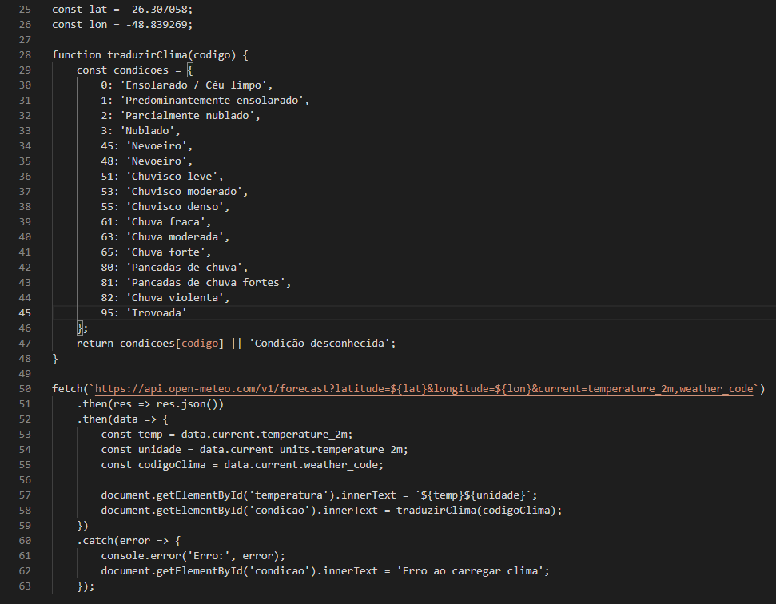

# Relatório Do Uso da IA Entrega 10

## API de Meteorologia

Foi usado o Google Gemini:

### Prompts

Faz um código que puxa a API mais fácil de ser utilizada que mostre a temperatura e o estado do clima se possível

### Objetivo e Observações

O objetivo principal é realizar a funcionalidade requisitada pela entrega:

* Informações meteorológicas obtidas pela API de clima.

Não houveram erros e nem limitações durante a execução da IA, e o teste executado foi somente com a visualização da funcionalidade ativa, com administrador e usuário

### Alterações da equipe no código

Tiramos emojis e mudamos um pouco a descrição dos estados do clima, além de também colocamos a localização fixa de Joinville/Bucarein para adaptar ao bloqueio que o SESI dá à localização dos computadores.

### Código

